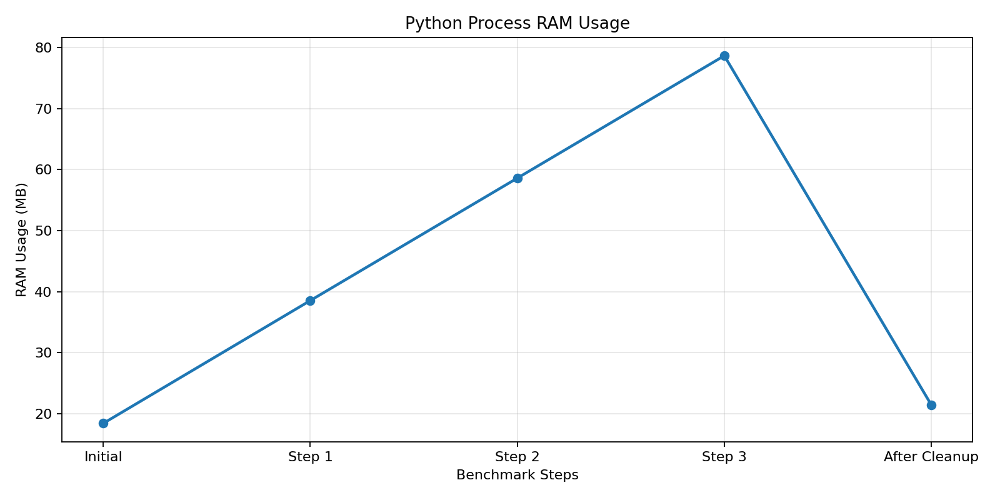

# RAM Usage Monitor Lab

Python ile **büyük listeler oluşturulurken bir sürecin (process) RAM kullanımının nasıl değiştiğini** gözlemleyen küçük bir bellek izleme laboratuvarı.

Bu çalışma, önceki [CPU Cache Benchmark Lab](../01-cpu-cache-benchmark/README.md) deneyinin devamıdır. İlk laboratuvarda _erişim düzeninin süreye etkisi_ incelenirken burada _nesnelerin yaşam süresinin ve bellek tahsisinin process belleğine etkisi_ incelenir.

## İçindekiler

1. [Amaç](#amaç)
2. [RAM ve process memory](#ram-ve-process-memory)
3. [Deneyin tasarımı](#deneyin-tasarımı)
4. [Kurulum ve çalıştırma](#kurulum-ve-çalıştırma)
5. [Ölçüm sonuçları](#ölçüm-sonuçları)
6. [Grafik](#grafik)
7. [Sonuçların yorumu](#sonuçların-yorumu)
8. [Sınırlılıklar ve geliştirme fikirleri](#sınırlılıklar-ve-geliştirme-fikirleri)
9. [Kaynaklar](#kaynaklar)

## Amaç

Şu üç soruya uygulamalı cevap arandı:

- Bir Python programı büyük listeler oluşturduğunda process RAM kullanımı artar mı?
- Önceden oluşturulan listelere olan referanslar tutulmazsa bellek kullanımı nasıl davranır?
- Listelerin referansları temizlendiğinde process RAM kullanımı azalır mı?

**Hipotez:** Her adımda 500.000 elemanlık yeni bir liste oluşturulup eski listelerin referansları korunursa bellek kullanımı genel olarak artar. Referanslar bırakıldığında ve nesneler temizlenebildiğinde görünen RAM kullanımı azalabilir; ancak ilk değere tamamen dönmek zorunda değildir.

## RAM ve process memory

**RAM (Random Access Memory)**, çalışan programların verilerinin ve kodlarının tutulduğu ana bellektir. Bir uygulamanın RAM kullanımı, bilgisayardaki toplam veya kullanılabilir RAM miktarı ile aynı kavram değildir.

Bu labda `psutil.Process(os.getpid()).memory_info().rss` kullanıldı:

- `os.getpid()` çalışan Python sürecinin kimliğini (PID) verir.
- `psutil.Process(...)` ilgili süreci temsil eder.
- `memory_info().rss` sürecin fiziksel bellekteki **resident set / working set** miktarını bayt olarak bildirir. Windows'ta `rss`, `wset` alanının takma adıdır.
- Değer `1_000_000`'a bölünerek **ondalık MB** birimine dönüştürülür. 1 MB = 1.000.000 bayt.

`rss` değeri, liste nesnelerinin kesin toplam boyutu veya yalnızca programın özel kullanımındaki bellek değildir. İşletim sisteminin gördüğü süreç çalışma kümesinin bir ölçüsüdür.

### Python listeleri neden bellek tüketir?

`list(range(500_000))`, 500.000 elemana erişim sağlayan bir Python listesi oluşturur. CPython'da liste elemanlarına referanslar, tamsayı nesneleri ve veri yapısının kendi yönetim alanları bellek kullanır. Bu nedenle _500.000 eleman = sabit bir MB değeri_ varsayımı doğru değildir.

## Deneyin tasarımı

1. Başlangıç process belleği ölçüldü.
2. Döngü üç kez çalıştırıldı: her adımda `list(range(500_000))` oluşturuldu.
3. Her liste `allocated_lists.append(numbers)` ile saklandı; böylece eski listeler erişilebilir kaldı.
4. Her adımdan sonra process RAM kullanımı `get_ram_usage()` ile ölçülerek `ram_history` listesine kaydedildi.
5. Adımlar arasında `time.sleep(1)` ile birer saniye beklendi; bu işlem belleği doğrudan artırmaz.
6. Temizleme aşamasında `allocated_lists.clear()` ve `del numbers` kullanılarak bütün oluşturulan listelere ait referanslar kaldırıldı.
7. Kısa beklemenin ardından RAM tekrar ölçüldü.
8. Ölçümler tamamlandıktan **sonra** Matplotlib yüklendi ve grafik `memory_usage.png` dosyasına kaydedildi; böylece grafik kütüphanesi başlangıç ölçümlerini etkilemedi.

Önceki bir karşılaştırma deneyinde `allocated_lists.append(numbers)` satırı kaldırılarak eski listelerin referanslarının korunmamasının etkisi de incelendi. Ayrıntılar [memory_notes.md](./memory_notes.md) dosyasında.

## Kurulum ve çalıştırma

**Gereksinimler:** Python 3.x, `psutil`, `matplotlib`.

Windows / Git Bash terminalinde proje klasöründeyken:

```bash
py -m pip install psutil matplotlib
py main.py
```

Program terminale RAM değerlerini yazar, grafik görüntüler ve proje klasöründe `memory_usage.png` oluşturur.

```text
02-ram-usage-monitor/
├── main.py
├── memory_usage.png
├── memory_notes.md
└── README.md
```

## Ölçüm sonuçları

**Son çalıştırmanın gerçek terminal çıktısı:**

```text
Initial RAM Usage: 18.41 MB
Step 1: RAM Usage: 38.53 MB
Step 2: RAM Usage: 58.59 MB
Step 3: RAM Usage: 78.65 MB

MEMORY RELEASE TEST
After cleanup: RAM Usage: 21.42 MB
```

| Aşama         | Process RAM (MB) | Önceki ölçüme göre değişim |
| ------------- | ---------------: | -------------------------: |
| Initial       |            18.41 |                          — |
| Step 1        |            38.53 |                  +20.12 MB |
| Step 2        |            58.59 |                  +20.06 MB |
| Step 3        |            78.65 |                  +20.06 MB |
| After Cleanup |            21.42 |                  −57.23 MB |

İlk ölçüm ile Step 3 arasındaki artış **60,24 MB**, Step 3 ile temizleme sonrası arasındaki azalma **57,23 MB** oldu. Temizleme sonrasındaki bellek, başlangıcın **3,01 MB** üzerindeydi.

Bu değerler tek bir çalıştırmaya aittir; farklı çalıştırmalarda sistem yüküne ve bellek yöneticisinin davranışına göre değişebilir.

### Referansları koruma karşılaştırması

Farklı iki çalıştırmada elde edilen önceki ölçümler:

| Aşama   | `append()` varken | `append()` yokken |
| ------- | ----------------: | ----------------: |
| Initial |          18.46 MB |          18.45 MB |
| Step 1  |          38.58 MB |          38.58 MB |
| Step 2  |          58.59 MB |          41.01 MB |
| Step 3  |          78.70 MB |          41.01 MB |

Referanslar saklandığında üç liste bellekte tutuldu ve ölçülen kullanım artmaya devam etti. `append()` kaldırıldığında her turda `numbers` yeni listeyi gösterdi; eski listelere başka referans kalmadığı için CPython bunların belleğini yeniden kullanılabilir hâle getirebildi. Bu ikinci koşulda Step 2 ile Step 3'ün RAM ölçümü aynı çıktı. Bu karşılaştırma iki ayrı süreç çalıştırmasına dayandığından tek tek sayılar tam kontrollü eşleştirilmiş ölçümler değildir.

## Grafik



Grafik, ölçüm aşamalarına karşılık gelen _process RAM_ değerlerini gösterir. Yatay eksen zaman (saniye) değil, **deney aşamasıdır**.

## Sonuçların yorumu

1. **Bellek tahsisi:** Üç adet 500.000 elemanlık liste saklanırken ölçülen process RAM değeri yaklaşık 18 MB'den 79 MB'ye çıktı. Bu uygulamada her yeni listenin saklanması yaklaşık 20 MB ek kullanım ile ilişkiliydi.
2. **Nesne yaşam süresi:** `append()` ile ek referans tutulduğunda eski listeler erişilebilir kaldı. Bu satır kaldırıldığında önceki listelere ait referanslar kayboldu ve bellek kullanımı artmaya devam etmedi.
3. **Temizleme:** `clear()` ve `del` sonrasında süreç çalışma kümesi 78,65 MB'den 21,42 MB'ye düştü. Bu, listelere ait referansların kaldırılmasının gözlemlenebilir etkisidir.
4. **Başlangıca tam dönüş olmadı:** Python'un bellek ayırıcısı, başka canlı nesneler ve işletim sisteminin çalışma kümesi yönetimi nedeniyle görünen RAM değeri başlangıç seviyesine eşit olmak zorunda değildir.

**Kritik ayrım:** Deney, temizleme sonrasında `gc.collect()` çağırmadı. CPython'un **referans sayımı** mekanizması, referansı kalmayan basit listelerin temizlenmesi için çoğunlukla yeterlidir; döngüsel referanslar için ayrıca garbage collector bulunur. RAM'deki düşüşün yalnızca döngüsel çöp toplayıcıdan kaynaklandığını söylemek doğru olmaz.

## Sınırlılıklar ve geliştirme fikirleri

- `rss`, süreç düzeyinde bir ölçümdür; yalnızca listedeki elemanların bellek tüketimini izole etmez.
- Windows çalışma kümesi yönetimi, işletim sistemi ve diğer uygulamalar ölçümleri değiştirebilir.
- Sonuçlar tek çalıştırma örnekleridir; farklı boyutlarda ve çoklu tekrarlarda ölçüm yapmak güvenilirliği artırır.
- Python nesnelerinin belleğinin boşaltılması, belleğin her zaman hemen işletim sistemine geri verileceği anlamına gelmez.
- Grafik süreç boyunca sürekli örneklenen zaman serisini değil, belirli aşamalarda alınmış beş ölçümü gösterir.
- Daha ileri testlerde liste boyutu (ör. 100.000 / 500.000 / 1.000.000), tekrar sayısı ve maksimum bellek kullanımı karşılaştırılabilir.
- `tracemalloc` ile Python tahsislerini inceleyip sonuçlar process `rss` ile karşılaştırılabilir; bu iki araç aynı şeyi ölçmez.

## Kaynaklar

- [psutil — Process.memory_info ve RSS](https://psutil.readthedocs.io/en/latest/#psutil.Process.memory_info)
- [Python 3.12 — `gc` modülü](https://docs.python.org/3.12/library/gc.html)
- [Python 3.12 — veri modeli ve nesne yaşam süresi](https://docs.python.org/3.12/reference/datamodel.html)
- [Python 3.12 — `sys.getsizeof`](https://docs.python.org/3.12/library/sys.html#sys.getsizeof)
- [Matplotlib — Quick start](https://matplotlib.org/stable/users/explain/quick_start.html)
