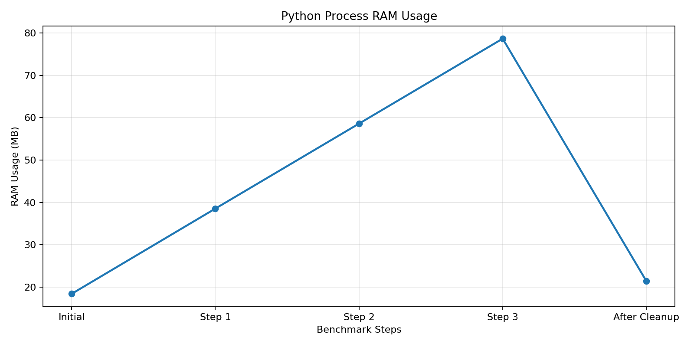

# RAM Usage Monitor — Öğrenme ve Deney Notları

Bu dosya, **02-ram-usage-monitor** laboratuvarında öğrendiğim bellek yönetimi kavramlarını, yaptığım deneyleri, gerçek terminal çıktılarımı ve bunlardan çıkarabildiğim/çıkaramadığım sonuçları toplar.

## 1. RAM nasıl çalışır?

**RAM (Random Access Memory):** Çalışan programların kodunun ve verilerinin tutulduğu ana bellektir. Kalıcı depolama (SSD/HDD) ile aynı şey değildir; normal koşullarda güç kesildiğinde RAM'deki içerik korunmaz. İşletim sistemi, programların kullanabileceği sanal adres alanlarını yönetir ve ihtiyaç duyulan fiziksel bellek sayfalarını süreçlere eşler.

**Process (süreç):** Çalışmakta olan program örneğidir. Aynı Python dosyasını iki kez çalıştırdığımda iki ayrı process oluşabilir ve her birinin PID'si, adres alanı ve bellek kullanımı vardır.

**PID (Process ID):** İşletim sisteminin çalışan süreçleri tanımlamak için kullandığı kimlik. `os.getpid()` ile kendi Python sürecimin PID'sini aldım.

**Bellek tahsisi (allocation):** Program yeni nesneler için belleğe ihtiyaç duyduğunda çalışma zamanı ve işletim sistemi aracılığıyla bellek ayırır. Python, tahsis edilen bellek alanlarını kendi bellek yöneticisi üzerinden yeniden kullanabilir.

**Bellek serbest bırakma (deallocation):** Artık kullanılmayan nesnelerin kaynaklarının geri kazanılabilir hâle gelmesidir. Bunun anlamı, işletim sisteminin gördüğü RAM kullanımının **mutlaka aynı anda veya aynı miktarda düşeceği** değildir.

## 2. Python listeleri neden RAM tüketir?

```python
numbers = list(range(500_000))
```

Bu ifade 500.000 elemanlı bir liste oluşturur. Standart CPython listesi, Python nesnelerine referanslar tutar. Tamsayı nesneleri, referans alanı ve listenin kendi yapısı birlikte bellek tüketir.

**Önemli:** `list(range(500_000))` için ne kadar RAM ayrılacağı; Python sürümü, çalışma zamanı, nesne yerleşimi, allocator davranışı ve ölçüm aracına göre değişir. Bu deneyde listelerin saklandığı çalıştırmada her yeni liste yaklaşık **20 MB** ilave process RSS kullanımıyla ilişkiliydi; bu evrensel bir sabit değildir.

### Neden ilk haftadaki `array("q")` ile farklı?

- **CPU Cache Benchmark Lab:** `array("q")` ile aynı tipteki tamsayılar daha kompakt bir bellekte tutuldu; amaç erişim düzeni ve performanstı.
- **RAM Usage Monitor Lab:** `list` kullanıldı; amaç Python nesneleri ve referanslarının process belleğine etkisiydi.

Bir başka fark: `sys.getsizeof(numbers)` yalnızca listeden doğrudan kaynaklanan boyutu gösterir; eleman olarak referans verilen nesnelerin bütün maliyetini doğrudan toplayıp vermez. Dolayısıyla bu proje için temel ölçüm `psutil` tarafından bildirilen **process memory** oldu.

## 3. RAM kullanımını nasıl ölçtüm?

```python
import os
import psutil

process = psutil.Process(os.getpid())

def get_ram_usage():
    memory_bytes = process.memory_info().rss
    return memory_bytes / 1_000_000
```

| İfade | Açıklama |
|---|---|
| `os.getpid()` | Mevcut sürecin PID'sini alır. |
| `psutil.Process(pid)` | Süreç hakkında bilgi almayı sağlar. |
| `memory_info()` | Sürecin bellek metriklerini döndürür. |
| `.rss` | Sürecin fiziksel bellekteki yerleşik/working set kullanımını raporlar. Windows'ta `wset` alanıyla eşdeğerdir. |
| `/ 1_000_000` | Baytı ondalık MB birimine dönüştürür. |

**RSS ≠ sistemin tamamındaki RAM tüketimi.** Ayrıca RSS, yalnızca Python listelerine özgü bellek miktarını da göstermez; yorumlayıcı ve yüklenmiş kütüphaneler dahil process çalışma kümesiyle ilgilidir.

Bu labdaki ölçümler Windows üzerinde Git Bash terminalinden `py main.py` çalıştırılarak gerçekleştirildi. Önceki labda aynı bilgisayar için **Intel Core i7-10750H** ve yaklaşık **16 GB RAM** bilgileri doğrulanmıştı. Python kurulum yolunda 3.12 görüldü; bu deneyde ayrıca sürüm sorgusu yapılmadı.

## 4. Deney A — Listelerin referanslarını saklamak

Kullandığım temel yaklaşım:

```python
allocated_lists = []

for step in range(1, 4):
    numbers = list(range(500_000))
    allocated_lists.append(numbers)
    # Bu aşamada get_ram_usage() ile ölçüm yapıldı.
```

`allocated_lists.append(numbers)`, her yeni listenin referansını ayrı bir koleksiyonda sakladı. Böylece bir sonraki turda `numbers` değişkeni yeni listeyi gösterse bile önceki listeler erişilebilir kaldı.

**Bu deneyin ilk ölçüm serisi:**

| Aşama | RAM (MB) |
|---|---:|
| Initial | 18.46 |
| Step 1 | 38.58 |
| Step 2 | 58.59 |
| Step 3 | 78.70 |

**Gözlem:** Liste sayısı arttıkça ölçülen süreç belleği de yükseldi. Başlangıçtan Step 3'e artış `78.70 - 18.46 = 60.24 MB` oldu.

## 5. Deney B — Referansları saklamamak

Karşılaştırma yapmak için yalnızca şu satırı devre dışı bıraktım:

```python
# allocated_lists.append(numbers)
```

**Bu ayrı çalıştırmada ölçülen sonuçlar:**

| Aşama | RAM (MB) |
|---|---:|
| Initial | 18.45 |
| Step 1 | 38.58 |
| Step 2 | 41.01 |
| Step 3 | 41.01 |

**Gözlem:** İlk turda bellek belirgin arttı, fakat ikinci ve üçüncü turda ilk deneydeki gibi düzenli artış gerçekleşmedi. `numbers` her turda yeni listeyi gösterdiği için önceki listenin başka referansı kalmadığında CPython bu nesnelerin belleğini yeniden kullanabildi.

**Teknik sınır:** Bu iki deney ayrı çalıştırmalar. Sadece bu sayılara bakarak Python'un tam olarak kaç baytı hangi anda işletim sistemine iade ettiğini söyleyemem.

## 6. Reference counting (referans sayımı)

CPython, nesnelerin yaşam süresini yönetmek için önemli ölçüde **referans sayımı** kullanır: Bir nesneye başka bir referans daha oluşursa referans sayısı artar; referanslar kaldırılınca azalır. Normal koşullarda referansı kalmayan döngüsel olmayan nesneler hızla temizlenebilir.

```python
numbers = [10, 20, 30]
other_numbers = numbers

del numbers
# Liste hâlâ other_numbers üzerinden erişilebilir.

del other_numbers
# Artık bu örnekte listeye bir referans kalmaz.
```

Bu labda:

- `numbers` her turun son listesine referans tutuyordu.
- `allocated_lists` bütün listelere referans tutuyordu.
- `allocated_lists.clear()` saklanan referansları kaldırdı.
- `del numbers` son kalan döngü değişkeni referansını da kaldırdı.

`del`, **nesneyi doğrudan işletim sistemi belleğinden sil** komutu değildir; bir ismin bağını siler veya bir kapsayıcıdaki öğeyi kaldırır. Nesnenin başka referansları bulunup bulunmaması yaşam süresini belirler.

## 7. Garbage collection (çöp toplama) ile farkı

Python'da *garbage collection* terimi, erişilemeyen nesnelerin temizlenmesini anlatan genel bir kavramdır. Ancak **CPython referans sayımı** ile ayrıca **döngüsel referansları tespit eden garbage collector** aynı mekanizma değildir.

Örneğin iki nesne birbirine referans veriyorsa ve dışarıdan erişilemiyorsa, referans sayıları sıfırlanmayabilir. CPython'un döngüsel çöp toplayıcısı bu tür erişilemeyen döngüleri bulmak için referans sayımını tamamlar.

Bu laboratuvarda `gc.collect()` kullanılmadı. Basit listelerin temizlenmesi için ayrıca `gc.collect()` çağırılması gerektiğini veya bellekteki düşüşün yalnızca döngüsel çöp toplayıcıdan kaynaklandığını iddia etmiyorum.

## 8. Deney C — Belleği serbest bırakmak

Bu kez `append()` tekrar aktif hâle getirildi. Üç liste oluşturulduktan sonra:

```python
allocated_lists.clear()
del numbers
time.sleep(1)
```

ile listelere ait referanslar kaldırıldı ve beklemeden sonra process RAM tekrar ölçüldü.

**İlk memory release testi:**

| Aşama | RAM (MB) |
|---|---:|
| Initial | 18.53 |
| Step 1 | 38.65 |
| Step 2 | 58.72 |
| Step 3 | 78.77 |
| After Cleanup | 20.50 |

Bu çalıştırmada Step 3 ile temizleme sonrası ölçüm arasındaki düşüş **58,27 MB** oldu.

**Grafiği oluşturan son çalıştırmanın ölçümleri:**

| Aşama | RAM (MB) | Fark (MB) |
|---|---:|---:|
| Initial | 18.41 | — |
| Step 1 | 38.53 | +20.12 |
| Step 2 | 58.59 | +20.06 |
| Step 3 | 78.65 | +20.06 |
| After Cleanup | 21.42 | −57.23 |

**Son çalıştırmanın analizi:**

- Üç listenin saklanması sırasında RAM kullanımı **60,24 MB** arttı.
- Temizleme sonrası ölçülen azalma **57,23 MB** oldu.
- Son RAM değeri başlangıçtan **3,01 MB** daha yüksekti.
- Bu fark, Python'un bellek ayırıcısı ve Windows çalışma kümesi yönetimi gibi etkenlerle uyumludur; elimizde bunun kesin nedenini ayıran ek ölçüm yoktur.

## 9. Matplotlib ile bellek grafiği

`steps` ve `ram_history` listelerine ölçüm aşamaları ve RAM değerleri eklendi. Ölçümler bittikten sonra `matplotlib.pyplot` içe aktarıldı.

```python
import matplotlib.pyplot as plt

plt.figure(figsize=(10, 5))
plt.plot(steps, ram_history, marker="o", linewidth=2)
plt.title("Python Process RAM Usage")
plt.xlabel("Benchmark Steps")
plt.ylabel("RAM Usage (MB)")
plt.grid(True, alpha=0.3)
plt.tight_layout()
plt.savefig("memory_usage.png", dpi=160)
plt.show()
```

Grafik, **Initial → Step 1 → Step 2 → Step 3** şeklinde yükselen bir çizgi ve **After Cleanup** noktasında düşüş gösterir. Bu grafik sürekli bir zaman ölçümü değildir: yalnızca belirli program aşamalarındaki örnekler birbirine bağlanmıştır.



## 10. `sys.getsizeof`, `tracemalloc` ve `psutil` farkı

| Araç | Ne hakkında bilgi verir? | Sınırlaması |
|---|---|---|
| `sys.getsizeof(obj)` | Tek nesnenin doğrudan boyutu | Alt nesnelerin belleğini otomatik olarak toplamaz. |
| `tracemalloc` | Python tarafından izlenebilen bellek tahsislerinin izi | Process'in bütün RSS'ini temsil etmez. |
| `psutil.Process(...).memory_info().rss` | Process'in fiziksel bellekteki çalışma kümesi | Tek bir Python listesinin tam boyutunu izole etmez. |

Bu nedenle *hangi metriği ölçtüğümü* raporda belirtmek önemlidir. `rss` değiştiğinde bunun tamamının yalnızca listelere ait bellek olduğunu varsaymamalıyım.

## 11. Ölçümlerin güvenilirliği ve geliştirme önerileri

1. Her test koşulunu birden fazla kez çalıştırıp medyan veya dağılım bilgisi kaydetmek.
2. 100.000, 500.000 ve 1.000.000 elemanlık listeler için artışı karşılaştırmak.
3. Aynı işlemleri farklı oturumlarda ve benzer sistem yükünde tekrarlamak.
4. `rss` ve `tracemalloc` bulgularını ayrı olarak karşılaştırmak.
5. Bellek temizlendikten sonra `gc.collect()` denemek; ancak `gc.collect()` çağrısının RAM'i işletim sistemine iade edeceğini varsaymamak.
6. Grafik üretimini bütün ölçümlerden sonra yapmaya devam etmek; Matplotlib importunun bellek tüketimini deneyle karıştırmamak.
7. İsteğe bağlı olarak bir sonraki çalışmada otomatik CSV kaydı ve daha fazla ölçüm noktası eklemek.

## 12. Öğrendiklerim ve sonuç

Bu laboratuvarla **RAM, process, PID, RSS, Python listeleri, referans sayımı, garbage collection, bellek tahsisi ve bellek serbest bırakma** kavramlarını çalıştım.

Deneysel olarak, oluşturduğum listelerin referanslarını sakladığımda RAM kullanımının yükseldiğini; referansları saklamadığımda önceki bellek alanlarının yeniden kullanılabildiğini; bütün liste referanslarını temizlediğimde ise görünen süreç RAM kullanımının belirgin biçimde azaldığını gözlemledim.

**En önemli çıkarım:** Python'da bir nesnenin yaşam süresi ile işletim sisteminin process için raporladığı RAM miktarı ilişkili olsa da aynı kavram değildir.

## Kaynaklar

- [psutil — Process memory bilgileri](https://psutil.readthedocs.io/en/latest/#psutil.Process.memory_info)
- [Python 3.12 — `gc` dokümantasyonu](https://docs.python.org/3.12/library/gc.html)
- [Python 3.12 — Data model](https://docs.python.org/3.12/reference/datamodel.html)
- [Python 3.12 — `sys.getsizeof`](https://docs.python.org/3.12/library/sys.html#sys.getsizeof)
- [Python 3.12 — `tracemalloc`](https://docs.python.org/3.12/library/tracemalloc.html)
- [Matplotlib — Quick start](https://matplotlib.org/stable/users/explain/quick_start.html)
